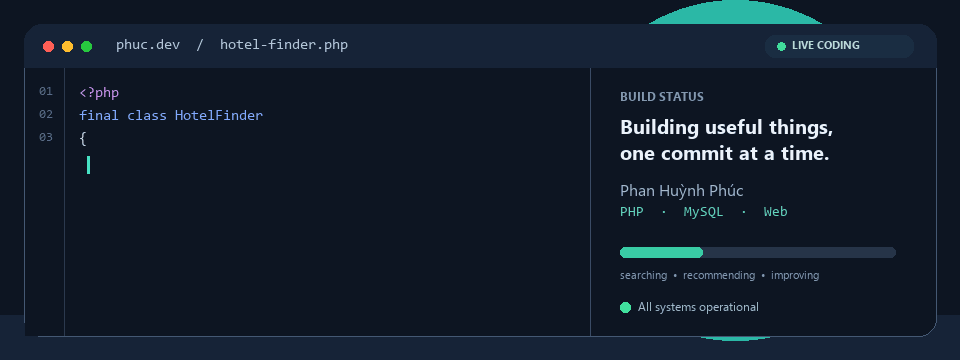

  <h1>Xin chào, mình là Phan Huỳnh Phúc</h1>
  
Sinh viên CNTT · DA23TTD · Việt Nam

  

## Đang thực hiện

- Xây dựng hệ thống hỗ trợ tìm kiếm và gợi ý khách sạn tại tỉnh Vĩnh Long.
- Tìm hiểu PHP, MySQL, phát triển web và thuật toán gợi ý theo nội dung.

## Công nghệ đang sử dụng

`PHP` · `MySQL` · `HTML` · `CSS` · `JavaScript` · `Bootstrap` · `Leaflet`

## Dự án đồ án

[Hệ thống tìm kiếm và gợi ý khách sạn Vĩnh Long](https://github.com/phuchuynh11zxjv-coder/cn-da23ttd-phanhuyhnphuc-timkhachsan-vinhlong)
